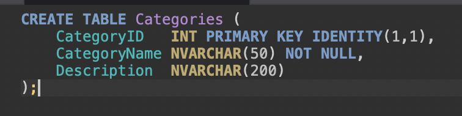
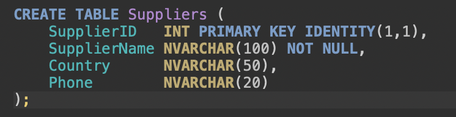
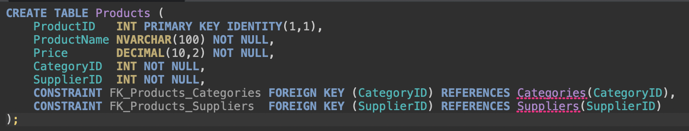
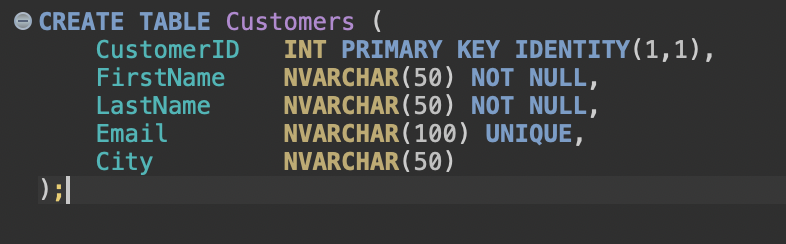
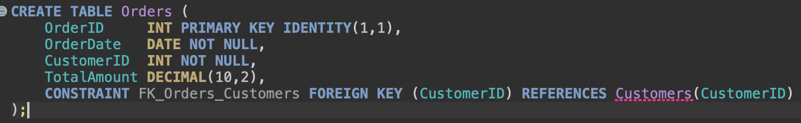
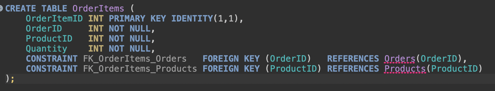
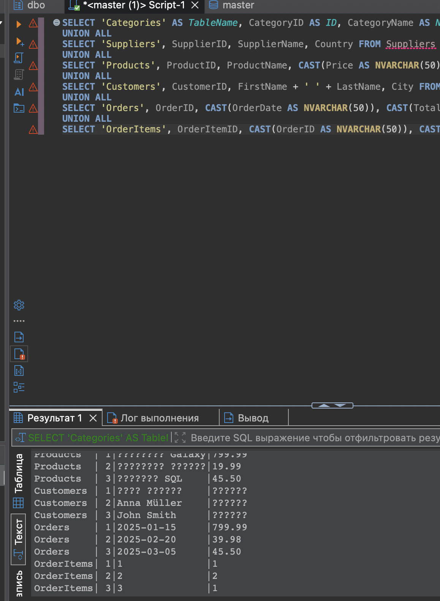

# Создание базы ShopDB и её таблиц

**Скриншот 1.** Создание базы данных ShopDB.

**Скриншот 2.** Создание таблицы Categories с идентификатором, названием категории и описанием.

**Скриншот 3.** Создание таблицы Suppliers с названием поставщика, страной и телефоном.

**Скриншот 4.** Создание таблицы Products с ценой, количеством на складе и внешними ключами на Categories и Suppliers.

**Скриншот 5.** Создание таблицы Customers с контактными данными клиента и уникальным Email.

**Скриншот 6.** Создание таблицы Orders и связи заказа с клиентом через внешний ключ CustomerID.

**Скриншот 7.** Создание таблицы OrderItems для строк заказа со связями на Orders и Products.

**Скриншот 8.** Окно SQL Server Management Studio с выполнением скрипта создания объектов ShopDB и просмотром результата.

