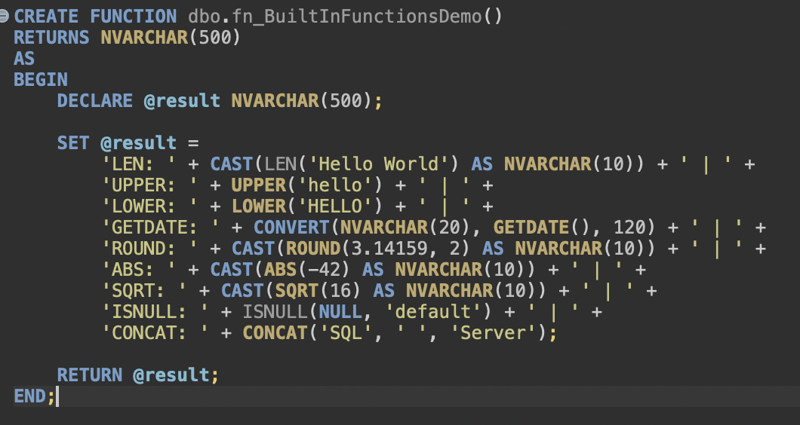
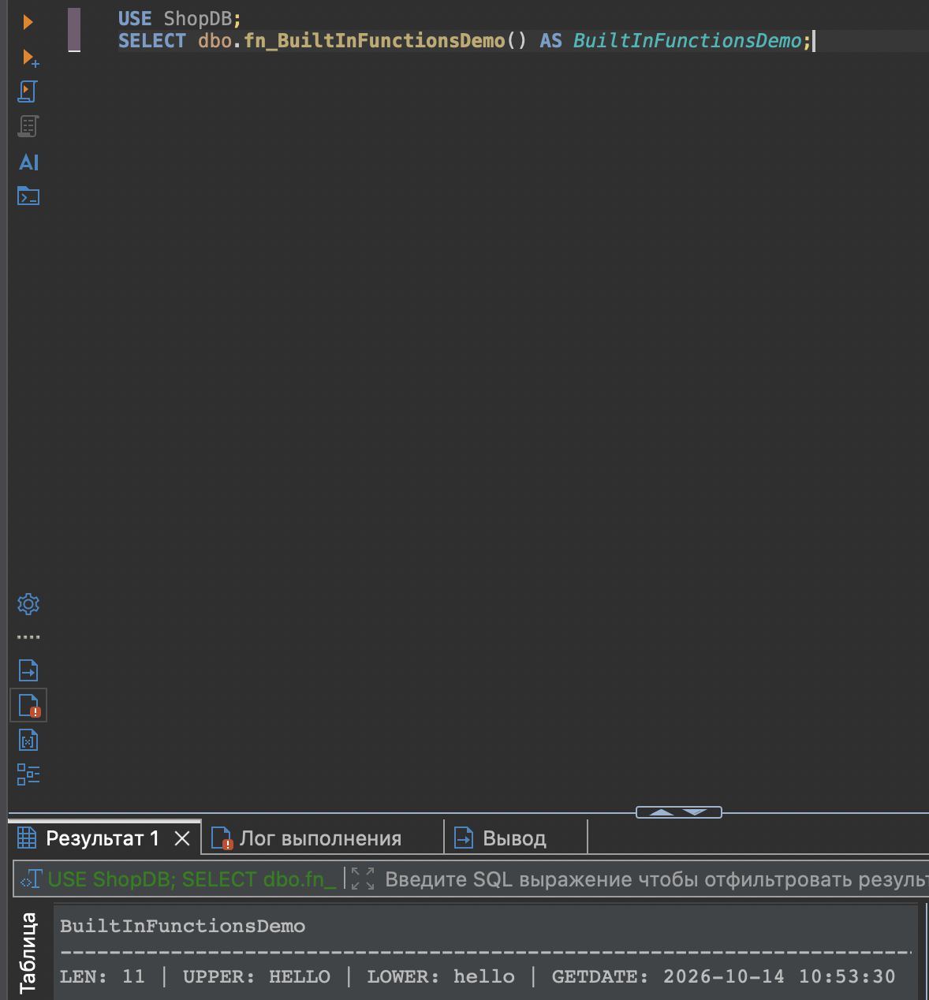
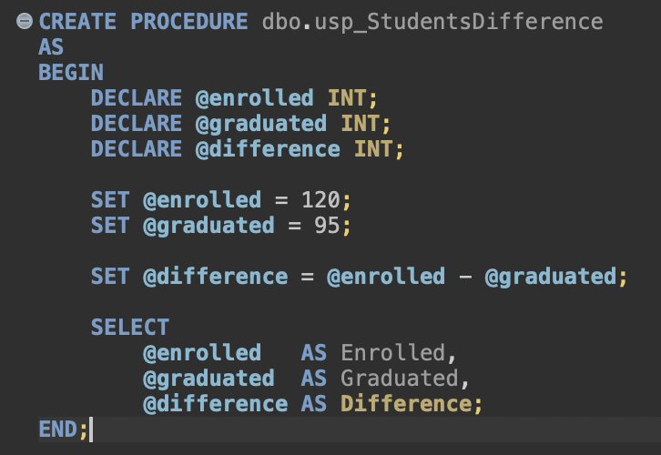
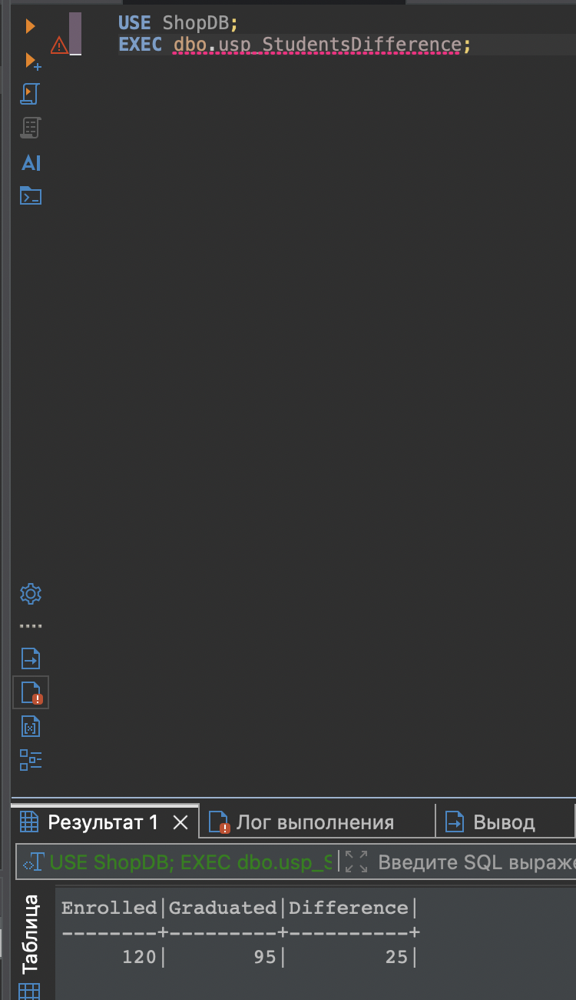

# Пользовательские функции и хранимая процедура

**Скриншот 1.** Создание скалярной функции dbo.fn_BuiltInFunctionsDemo, которая демонстрирует строковые, числовые и датовые встроенные функции SQL Server.

**Скриншот 2.** Вызов пользовательской функции и просмотр результата, объединяющего значения LEN, UPPER, LOWER, GETDATE, ROUND, ABS, SQRT, ISNULL и CONCAT.

**Скриншот 3.** Создание хранимой процедуры dbo.usp_StudentsDifference для сравнения количества зачисленных и выпустившихся студентов.

**Скриншот 4.** Выполнение хранимой процедуры и вывод рассчитанных значений Enrolled, Graduated и Difference.

