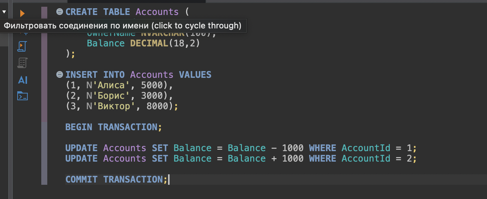
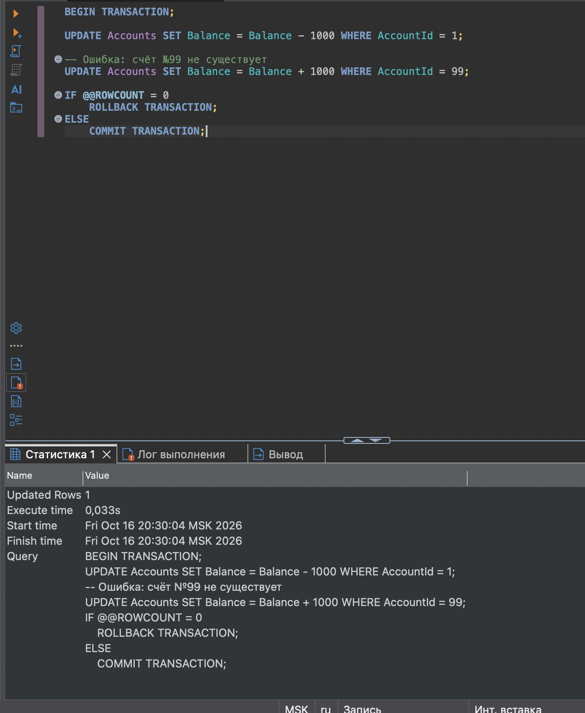
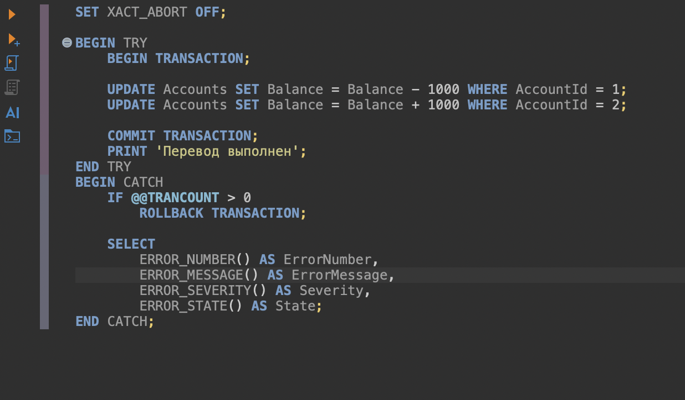
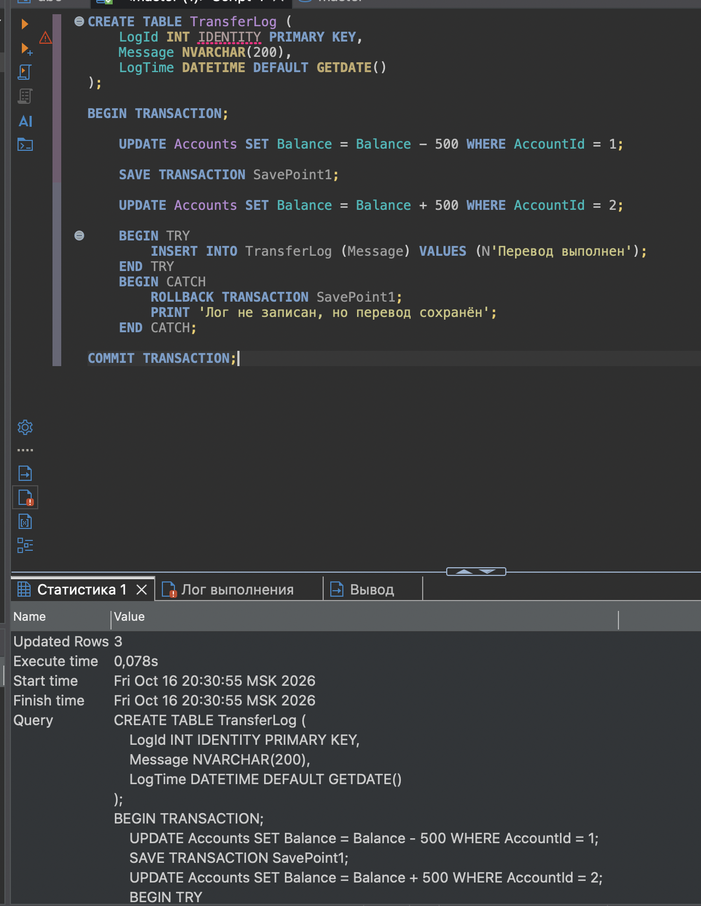
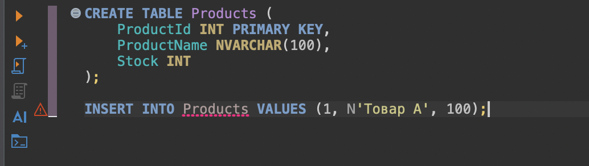
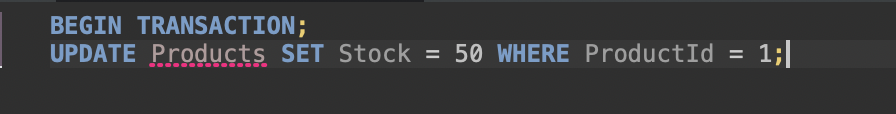

# Транзакции и обработка ошибок в SQL Server

**Скриншот 1.** Создание таблицы Accounts и пример перевода суммы между двумя счетами в транзакции с фиксацией через COMMIT.

**Скриншот 2.** Результат выполнения скрипта перевода средств: показаны сообщения SQL Server и выполнение команд транзакции.

## Этап 2

**Скриншот 3.** Обработка транзакции с XACT_ABORT OFF и блоком TRY/CATCH: обновление счетов, COMMIT при успехе и ROLLBACK при ошибке.

## Этап 3

**Скриншот 4.** Окно результатов выполнения блока TRY/CATCH с сообщениями о состоянии транзакции и диагностикой ошибки.

## Этап 4

**Скриншот 5.** Создание таблицы Products и добавление тестового товара с исходным запасом 100 единиц.

**Скриншот 6.** Пример транзакционного изменения количества товара: обновление Stock до 50 для ProductId = 1.

