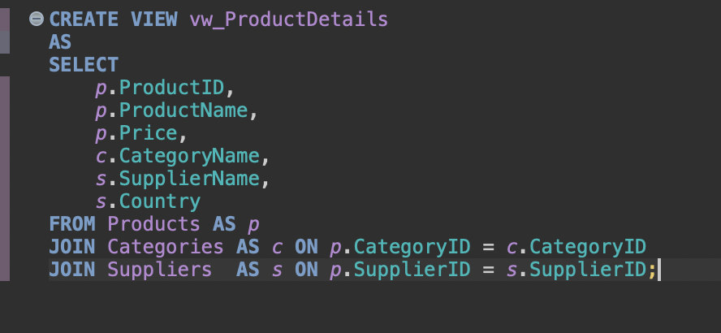
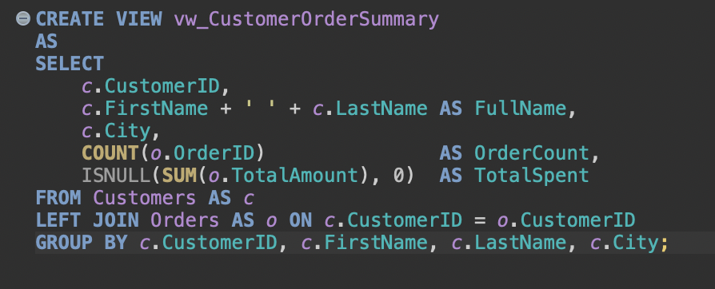
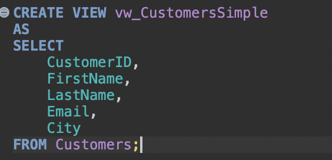
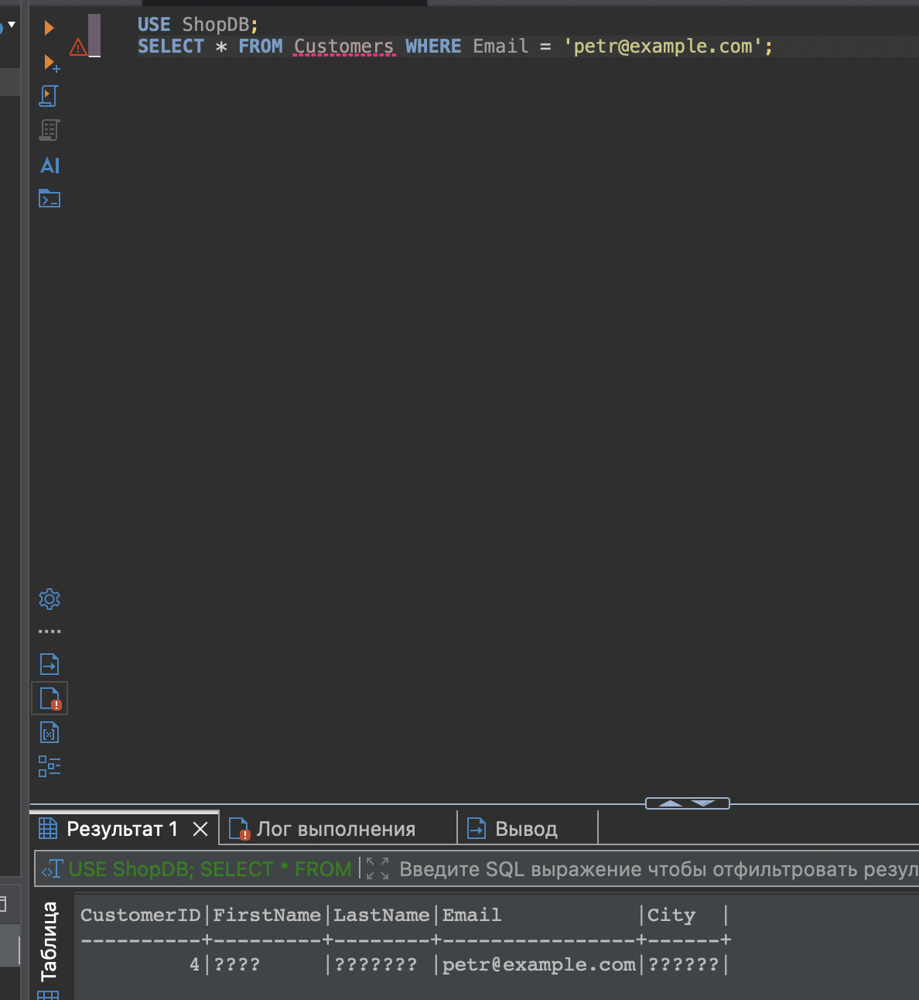

# Представления SQL Server для базы ShopDB

**Скриншот 1.** Создание представления vw_ProductDetails: товары объединяются с категориями и поставщиками.

**Скриншот 2.** Создание представления vw_CustomerOrderSummary, которое выводит клиентов, количество заказов и общую сумму покупок.

**Скриншот 3.** Создание простого представления vw_CustomersSimple с основными полями таблицы Customers.

**Скриншот 4.** Вставка тестового клиента через представление vw_CustomersSimple в базе ShopDB.

**Скриншот 5.** Результат выполнения SQL-запроса и проверка добавленной записи клиента в базе ShopDB.

