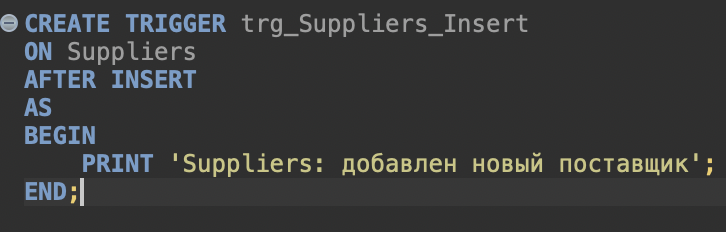
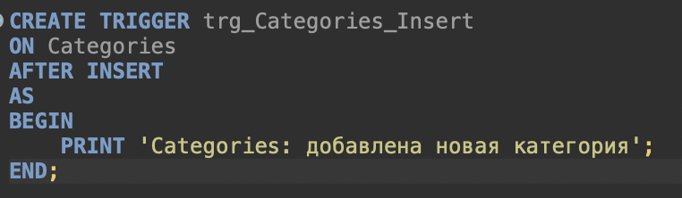
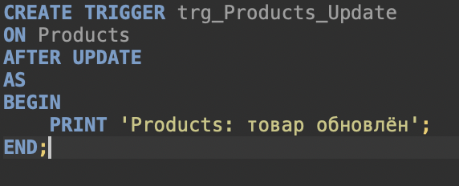
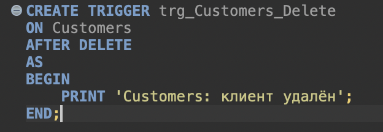
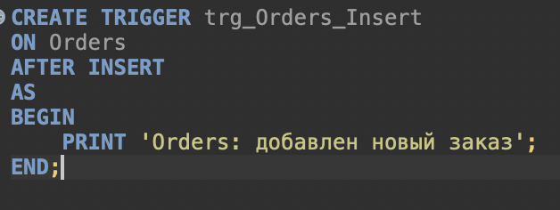
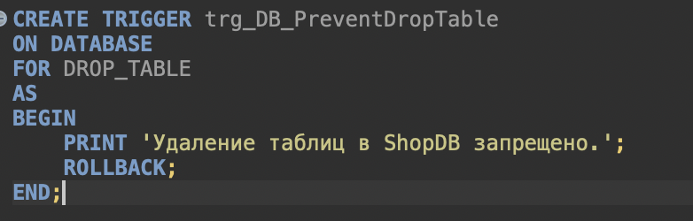
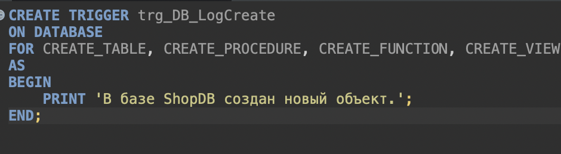

# Триггеры DML и DDL в SQL Server

**Скриншот 1.** Создание DML-триггера trg_Suppliers_Insert, который выводит сообщение после добавления поставщика.

**Скриншот 2.** Создание DML-триггера trg_Categories_Insert, который сообщает о добавлении новой категории.

**Скриншот 3.** Создание DML-триггера trg_Products_Update, срабатывающего после обновления товара.

**Скриншот 4.** Создание DML-триггера trg_Customers_Delete, который выводит сообщение после удаления клиента.

**Скриншот 5.** Создание DML-триггера trg_Orders_Insert, который сообщает о добавлении нового заказа.

**Скриншот 6.** Создание DDL-триггера trg_DB_PreventDropTable, запрещающего удаление таблиц в базе ShopDB с помощью ROLLBACK.

**Скриншот 7.** Создание DDL-триггера trg_DB_LogCreate, реагирующего на создание таблиц, процедур, функций и представлений в базе данных.

